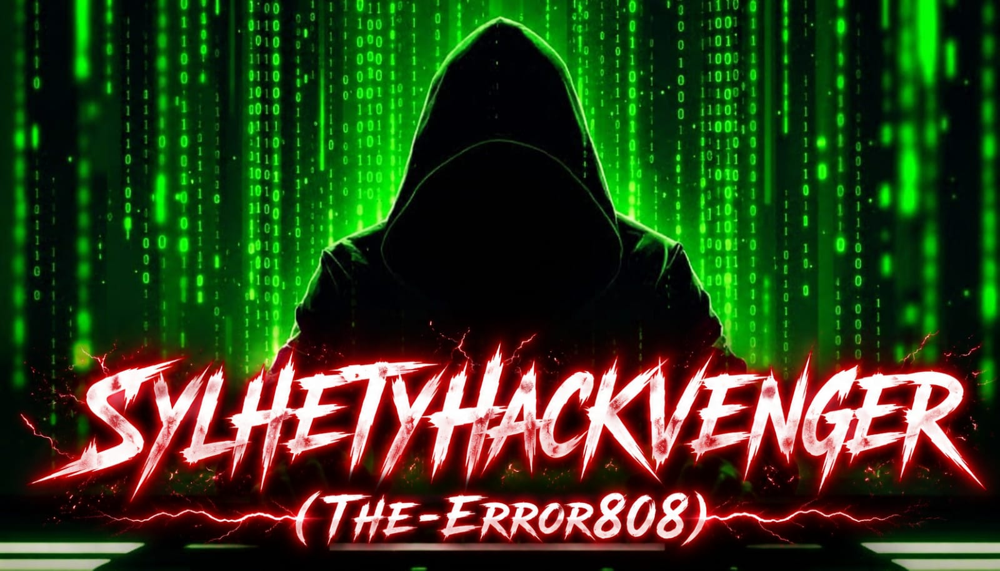

<div align="center">

<a href="https://github.com/sylhetyhackvenger">
  
</a>

<br/>


</div>

---

<div align="center">

### `root@THE-ERROR808:~# ./tech_stack --list`


</div>

---

<div align="center">

### `./stats --live --github`


</div>

---

<div align="center">

### `./contact --open-channel`

[


](https://instagram.com/sylhetyhackvenger_)
[


](https://github.com/sylhetyhackvenger)

<br/>

<sub>Gray Hat Hacking for educational research purposes only.</sub>
<br/>
<sub>© THE-ERROR808 — Mission: Defend. Research. Explore. Repeat.</sub>

</div>
<!-- ================= HERO BANNER ================= -->

<p align="center">
  
</p>

<p align="center">
  
</p>

<p align="center">
  
</p>

<!-- ================= FOOTER ================= -->

## 👨‍💻 IDENTITY

```yaml
Alias: SYLHETYHACKVENGER
Codename: THE-ERROR808

Focus:
  - Cybersecurity Research
  - Network Auditing
  - Digital Reconnaissance
  - OSINT Intelligence
  - Ethical Hacking Labs
  - Capture The Flag
Nature:
  - Defensive
  - Offensive
  - Gray Hat Hacker
Environment:
  - Kali Linux
  - Termux
  - Linux Servers
  - Cloud Infrastructure
Rank:
  - 1st Gray Hat Hacker Competition Winner (CTF BD REGION)
  - 1st Python Program Contest Winner (SYLHET)
  - 3rd C Program Contest Winner (SYLHET)
Status: ONLINE
Threat Level: UNKNOWN
```

---

## ⚡ LIVE STATUS

<p align="center">


</p>

---

## 🌐 CONNECT

<p align="center">

<a href="https://instagram.com/sylhetyhackvenger_">

</a>

</p>

---

# 🧠 NEURAL TECH STACK

<p align="center">


</p>

---

# 🔥 SYSTEM ANALYTICS

<p align="center">


</p>

<p align="center">


</p>

---

# 🏆 FORGET ABOUT THE ACHIEVEMENTS JUST SWAG

<p align="center">

<p align="center">
  
</p>

</p>

---

<!-- ================= VISITOR SCANNER ================= -->

<h2 align="center">🛰 VISITOR SCANNER</h2>

<p align="center">
  
</p>

<p align="center">
  
</p>

<p align="center">
  
</p>

<p align="center">
══════════════════════════════════════════
<br>
⚡ THREAT ANALYSIS ACTIVE • RECON ONLINE • CYBER GRID SECURED ⚡
<br>
══════════════════════════════════════════
</p>
---

# ☄️ STAY WITH ME

<p align="center">


</p>

---

<p align="center">
  
</p>

# 🎭 SYSTEM TERMINAL
```bash
root@sylhetyhackvenger:~#

> Reconnaissance Active
> Monitoring Attack Surface
> Tracking Vulnerabilities
> Learning Never Stops

Mission:
Defend.
Research.
Explore.
Repeat.
```

---
```ansi
████████████████████████████████████████████

 SYSTEM STATUS  : ONLINE
 THREAT LEVEL   : MONITORED
 NETWORK STATE  : STABLE
 RECON MODE     : ACTIVE

████████████████████████████████████████████
```

---

```diff
+ ACCESS GRANTED
+ SESSION LOGGED
+ CYBER GRID OPERATIONAL
```

<p align="center">

### 「 SYLHETYHACKVENGER 」
  
</p>

<h1 align="center">
⚡ SYLHETYHACKVENGER (THE-ERROR808) ⚡
</h1>

<p align="center">
Rooted Execution • Network Auditing • Digital Recon • Termux & Kali Linux Powered Lab Test
</p>

---

<!-- YOUR README CONTENT HERE -->

```diff
+ ENTER THE CYBER ZONE
+ STAY CURIOUS
+ STAY ETHICAL
+ KEEP LEARNING
```

</p>
